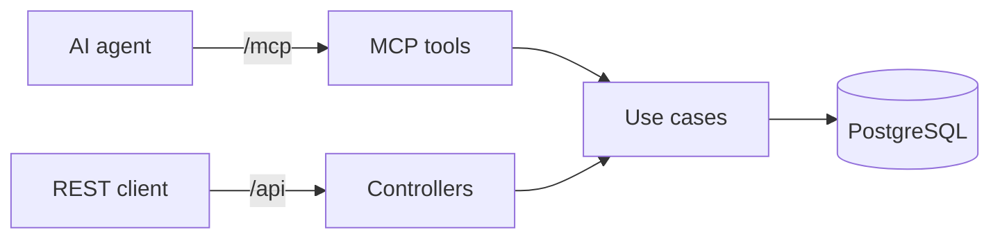

# ReserveHub Lite

Booking API for rooms, desks and equipment with a read-only **MCP server**. No double booking, even under concurrent requests.

.NET 10 · ASP.NET Core · EF Core 10 · PostgreSQL 17 · ModelContextProtocol 2.2 · Testcontainers

> [!TIP]
> ```bash
> docker compose up --build
> claude mcp add --transport http reservehub http://localhost:8080/mcp
> ```
> Ask: *"Which room for 6 people is free tomorrow 14:00–15:00?"*

## MCP

`http://localhost:8080/mcp` · Streamable HTTP · stateless



| Tool | Parameters |
|---|---|
| `search_resources` | `type?`, `minCapacity?` |
| `get_availability` | `resourceId`, `start`, `end` |
| `get_booking` | `bookingId` |

Tools are read-only and call the same use cases as the REST controllers. Failures return a tool error with the code, e.g. `booking.not_found`.

Other clients:

```json
{ "servers": { "reservehub": { "type": "http", "url": "http://localhost:8080/mcp" } } }
```

```bash
npx @modelcontextprotocol/inspector
```

## Run

```bash
docker compose up --build
```

API `http://localhost:8080` · Scalar `/scalar` · MCP `/mcp`

From the IDE:

```bash
docker compose up db
dotnet run --project src/ReserveHub.Api
```

API `http://localhost:5080`

## REST API

| Method | Route | Success | Errors |
|---|---|---|---|
| `GET` | `/api/resources?type=Room&minCapacity=4` | `200` | |
| `GET` | `/api/resources/{id}/availability?start=...&end=...` | `200` | 400, 404 |
| `POST` | `/api/bookings` | `201` | 400, 404, 409 |
| `GET` | `/api/bookings/{id}` | `200` | 404 |
| `POST` | `/api/bookings/{id}/cancel` | `200` | 404, 409 |

```bash
curl -i -X POST http://localhost:8080/api/bookings \
  -H "Content-Type: application/json" \
  -d '{"resourceId":"11111111-1111-1111-1111-111111111111","bookedBy":"Anna","start":"2030-01-01T10:00:00Z","end":"2030-01-01T11:00:00Z"}'
```

Errors are ProblemDetails with the error code in `title`. More requests: [`ReserveHub.Api.http`](src/ReserveHub.Api/ReserveHub.Api.http).

| Seeded resource | Id | Type | Capacity |
|---|---|---|---|
| Room Alpha | `11111111-1111-1111-1111-111111111111` | Room | 6 |
| Room Beta | `22222222-2222-2222-2222-222222222222` | Room | 12 |
| Desk 12 | `33333333-3333-3333-3333-333333333333` | Desk | 1 |
| Desk 14 | `44444444-4444-4444-4444-444444444444` | Desk | 1 |
| Projector P1 | `55555555-5555-5555-5555-555555555555` | Equipment | 1 |

## Business rules

| Rule | Result |
|---|---|
| `start >= end` | `400 booking.invalid_period` |
| `start` in the past | `400 booking.in_past` |
| `bookedBy` empty or over 100 characters | `400 booking.invalid_booked_by` |
| Overlaps a confirmed booking | `409 booking.overlap` |
| Adjacent slots (`10–11`, `11–12`) | allowed |
| Cancel twice | `409 booking.already_cancelled` |
| Unknown resource / booking | `404` |
| Concurrent requests for one slot | one `201`, the rest `409` |

Ranges are half-open `[start, end)`: overlap is `start1 < end2 && start2 < end1`.

## Architecture

```
src/
  ReserveHub.Domain          entities, rules, Result
  ReserveHub.Application     use cases, DTOs, IAppDbContext
  ReserveHub.Infrastructure  EF Core, migrations, seed
  ReserveHub.Api             controllers, MCP tools, startup
tests/
  ReserveHub.UnitTests
  ReserveHub.IntegrationTests
```

## Tests

`dotnet test` (Docker required)

- `TimeRange.Overlaps`: overlapping ranges conflict, adjacent ones don't.
- 10 parallel `POST`s for one slot against real PostgreSQL: one `201`, nine `409`, one row.

## Design decisions

- PostgreSQL exclusion constraint closes the race between the overlap check and the insert.
- No Repository / Unit of Work over EF Core.
- `Result` for expected errors, exceptions for unexpected ones.
- Times are stored in UTC.
- `TimeProvider` instead of `DateTime.UtcNow`.
- Testcontainers instead of EF InMemory.

## Roadmap

OAuth for MCP, MCP write tools, editing bookings, idempotency keys, outbox, OpenTelemetry.
